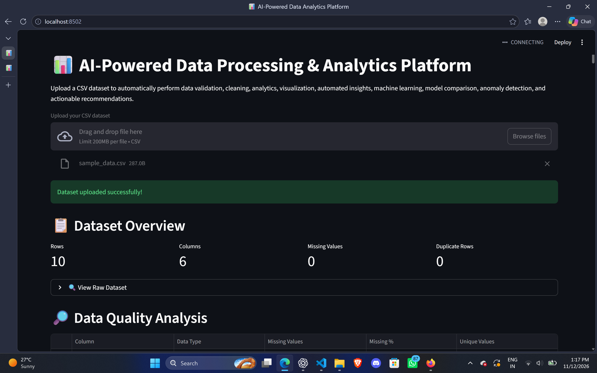
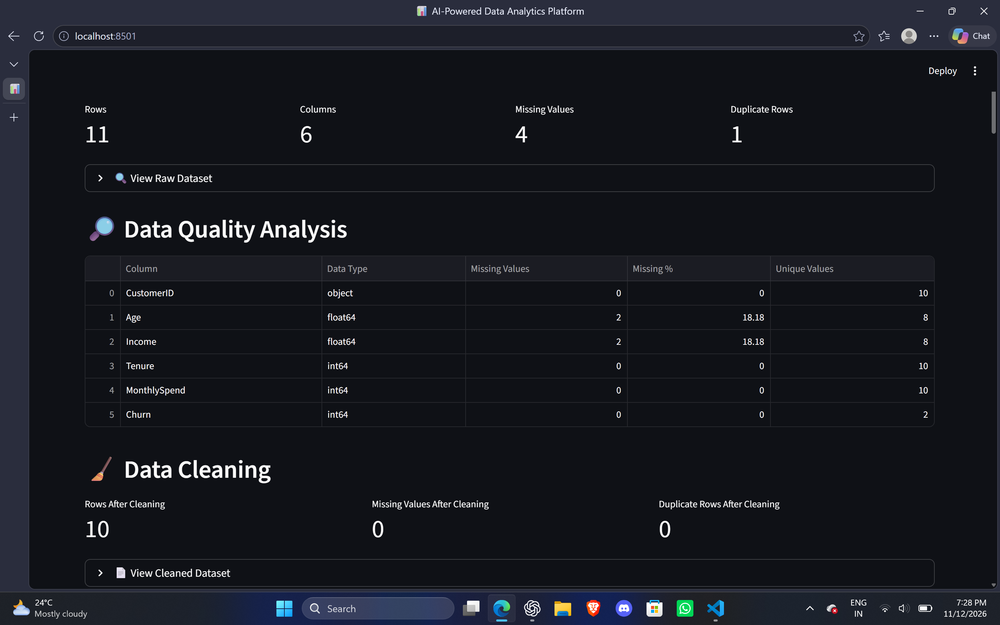

<div align="center">

# InsightFlow

### AI-Powered Data Processing & Analytics Platform

**Turn raw CSV data into clear analysis, visualizations, machine-learning results, and actionable recommendations.**

[](https://www.python.org/)
[](https://streamlit.io/)
[](https://scikit-learn.org/)
[](LICENSE)

</div>

---

## Overview

InsightFlow is a Python-based data analytics platform built with Streamlit. It combines data preprocessing, exploratory data analysis (EDA), visualization, and machine learning in an interactive application.

Upload a CSV dataset to inspect data quality, clean the data, explore statistical patterns, run selected machine-learning tasks, and review automatically generated insights and recommendations.

## Application Preview

### Dashboard



### Data quality analysis



## Features

| Feature | What it does |
|---|---|
| **CSV upload** | Load a dataset directly into the Streamlit application. |
| **Dataset overview** | Review row and column counts, missing values, and duplicate records. |
| **Data profiling** | Inspect column types and dataset quality characteristics. |
| **Data cleaning** | Handle missing values and remove duplicate records. |
| **Exploratory data analysis** | Review summary statistics, KPIs, and correlation analysis. |
| **Data visualization** | Explore numerical distributions, categorical distributions, correlations, and relationships between variables. |
| **Automated insights** | Generate analytical findings from the processed dataset. |
| **Classification** | Compare Logistic Regression, Random Forest, and Gradient Boosting models. |
| **Regression** | Train a Linear Regression model and review evaluation metrics. |
| **Clustering** | Group records using K-Means clustering. |
| **Anomaly detection** | Identify unusual records using Isolation Forest. |
| **Recommendations** | Generate recommendations using dataset characteristics and available analysis results. |
| **Downloads** | Export cleaned data, analytics reports, model comparisons, anomaly results, and recommendations. |

## Technology Stack

| Category | Technologies |
|---|---|
| Programming language | Python |
| Data processing | Pandas, NumPy |
| Machine learning | Scikit-learn |
| Visualization | Matplotlib, Seaborn |
| Application framework | Streamlit |
| Testing | Pytest |
| Spreadsheet support | OpenPyXL |

## Project Structure

```text
AI-Powered-Data-Analytics-Platform/
├── app.py
├── data/
│   ├── sample_data.csv
│   └── messy_data.csv
├── docs/
│   └── images/
│       ├── dashboard.png
│       └── data-quality.png
├── src/
│   ├── __init__.py
│   ├── data_loader.py
│   ├── data_cleaner.py
│   ├── analytics.py
│   ├── visualization.py
│   ├── ml_models.py
│   ├── insights.py
│   ├── recommendations.py
│   └── logger.py
├── tests/
│   ├── __init__.py
│   ├── test_data_loader.py
│   ├── test_data_cleaner.py
│   ├── test_analytics.py
│   ├── test_visualization.py
│   ├── test_ml_models.py
│   ├── test_advanced_ml.py
│   └── test_recommendations.py
├── .gitignore
├── LICENSE
├── README.md
└── requirements.txt
```

## Getting Started

### Prerequisites

- Python 3.9 or later
- Git

### 1. Clone the repository

```bash
git clone https://github.com/gaytrij/insightflow-data-analytics.git
cd insightflow-data-analytics
```

### 2. Create a virtual environment

```bash
python -m venv .venv
```

### 3. Activate the virtual environment

**Windows PowerShell**

```powershell
.\.venv\Scripts\Activate.ps1
```

If PowerShell blocks script activation, use Command Prompt instead:

```bat
.venv\Scripts\activate.bat
```

### 4. Install dependencies

```bash
python -m pip install --upgrade pip
python -m pip install -r requirements.txt
```

### 5. Run the application

```bash
python -m streamlit run app.py
```

Streamlit will print a local URL in the terminal. Open that URL in your browser, then upload a CSV file to begin.

## Running Tests

Run the test suite from the project root:

```bash
python -m pytest
```

**Latest verified result:** 27 tests passed. The run also reported 14 warnings, including Matplotlib/Pyparsing deprecation warnings; there were no test failures in that run.

## How to Use

1. Start the Streamlit application.
2. Upload a CSV dataset.
3. Review the dataset overview and data-quality report.
4. Inspect the cleaned dataset and download it if needed.
5. Explore KPIs, summary statistics, correlations, and visualizations.
6. Select an available machine-learning task and configure its inputs.
7. Run anomaly detection when the dataset has enough numerical features.
8. Review the generated insights and recommendations.
9. Download the reports you need.

## License

This project is licensed under the MIT License. See [LICENSE](LICENSE) for details.

## Author

**Gayatri Kishor Jadhav**

- GitHub: [@gaytrij](https://github.com/gaytrij)
- Repository: [insightflow-data-analytics](https://github.com/gaytrij/insightflow-data-analytics)

---

<div align="center">

Built with Python, Streamlit, and Scikit-learn.

</div>
